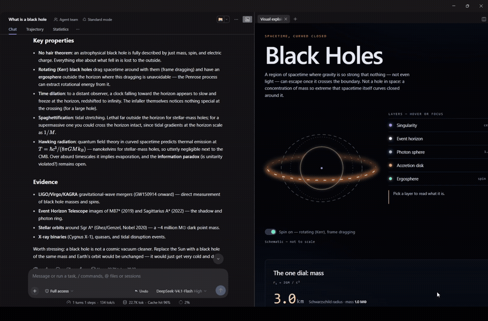

# dsh-reply-visualizer

A [DeepSeek Harness](https://github.com/deepseek-ai/deepseek-harness) plugin that turns a long
assistant reply into **one self-contained HTML page** that explains the idea visually.

The model reads the reply, decides what kind of visual the idea actually needs, and writes the page
itself — diagram, palette, motion, and interactions included. Nothing is templated: a reply about a
pipeline becomes an animated flow, one about a trade-off becomes a draggable comparison, one about
load becomes a chart you can poke at.



## What it does

Press the small cards icon under any long reply:

1. the reply is sent to your model with a design brief, not a template
2. the model returns one complete HTML document — inline CSS and JS, no build step
3. it is saved to disk as a single file, and a toast appears bottom-right with progress
4. clicking the toast opens the page in the right sidebar

Every page is kept. The **cards icon in the left sidebar** opens a gallery, grouped by chat, so a
conversation with four explanations keeps its four pages together.

## Requirements

- DeepSeek Harness with the web UI
- A model route (the plugin borrows whatever model the current session is already using)
- No image generation, no GPU, no external service

## Install

```bash
git clone https://github.com/YOUR-GITHUB-USER/dsh-reply-visualizer.git
```

Then, from a Harness session, install the checkout as a bundle:

```
plugin_manager  action: install_bundle  target: <absolute path to the clone>
```

Or use **Settings → Plugins → Add** and point it at the folder. Restart the app once so the Host
half loads, then refresh the page.

## How it works

| half | file | job |
| --- | --- | --- |
| Host | `index.js` | one model call, the page on disk, the index, four routes |
| Client | `client.js` | the icon, the toast, the pane, the gallery |

Routes, all under `/dsh-reply-visualizer`:

- `POST /build` — `{ text, id, sessionId, sessionTitle }` → asks the model for the page, saves it, indexes it
- `GET /page/<id>` — serves a saved page
- `GET /index` — the gallery manifest
- `POST /diag` — the browser reports a failed job, so failures land in a log

Slots it fills:

- `conversation.chat.assistant-actions` — the icon under a reply
- `shell.overlay` — the job toast
- `sidebar.right.pane.tab` — the page itself
- `sidebar.panellist` + `main` — the gallery

## The prompt is the product

Everything interesting lives in `HTML_PROMPT` in `index.js`. It does not describe a layout; it tells
the model how to *choose* one, then constrains the things that go wrong:

- at most three paragraphs of prose; everything else is labels, numbers and structure
- interactions must teach something true — no control that does nothing
- the page must still read with all interactivity disabled, and work by keyboard
- palette is chosen per reply and declared once in `:root`; no default house style
- no `` tags: diagrams are drawn in SVG or mermaid, so labels cannot be misspelled
- mermaid, chart.js, rough.js, d3 and three.js are the only allowed CDN imports

If you want different output, edit that string. It is the whole design.

## Configuration

Both optional, set on the plugin's config row:

| key | default | meaning |
| --- | --- | --- |
| `pageDir` | `~/.dsh-reply-visualizer/pages` | where pages and `index.json` are written |
| `stallTimeoutMs` | `90000` | abort a model call only after this long with **no output at all** |

There is deliberately no output-token cap and no wall-clock deadline: both turn a slow-but-good
answer into an error.

## Development

```bash
npm test
```

Three suites, no framework:

- `test/host.test.mjs` — routes, graceful failures, HTML extraction, title fallback, serving
- `test/classnames.test.mjs` — every class the JS references is styled, and every styled class is referenced
- `test/client-smoke.mjs` — loads the real client module with stubbed React, registers every slot and
  invokes every component, which is what catches a dangling reference before it blanks the UI

## Licence

MIT — see [LICENSE](LICENSE).
